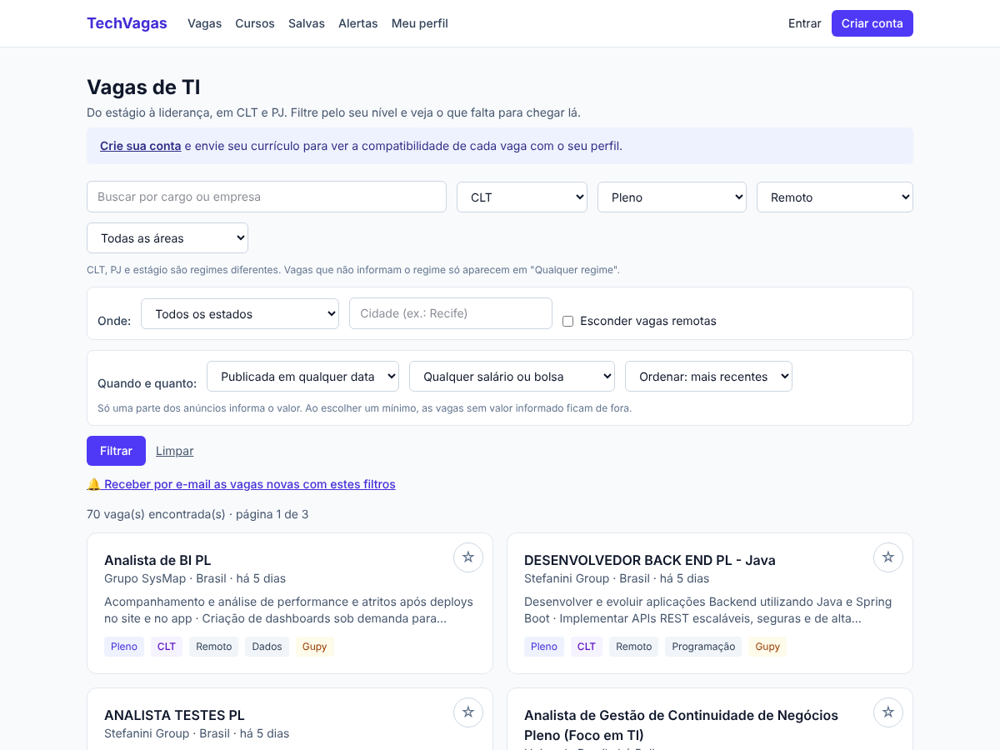
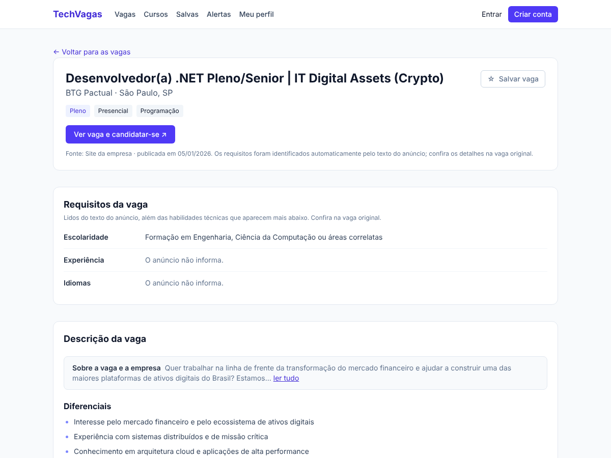
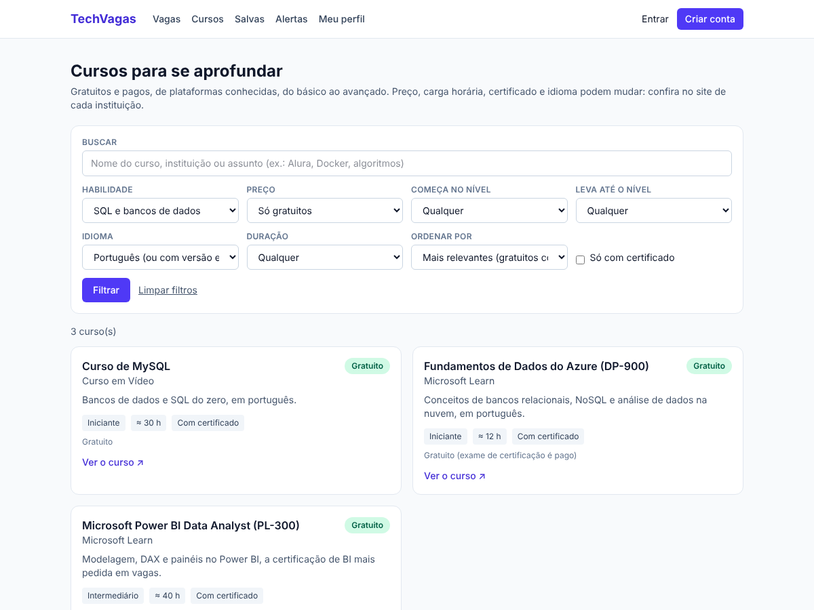

# TechVagas

**Site de vagas de TI no Brasil, do estágio à liderança, em CLT, PJ e estágio, que também diz o que estudar para chegar lá.**

Projeto pessoal feito com Next.js, TypeScript e Prisma. Reúne milhares de vagas de várias fontes, compara o currículo
de quem procura com os requisitos de cada vaga e indica cursos gratuitos e pagos, com certificado, para fechar o que falta.



## Destaques

- **Vagas de todos os níveis e regimes:** CLT, PJ e estágio vêm primeiro nos filtros, e os níveis mudam conforme o
  regime (estágio não tem nível; PJ não tem trainee). Filtros também por modalidade, área, estado, cidade, data de
  publicação e salário mínimo.
- **Várias fontes, uma só lista:** Gupy, Adzuna, Jooble, páginas de carreira de empresas (Greenhouse, Lever e Ashby),
  Remotive e comunidades do GitHub. A mesma vaga vinda de duas fontes aparece uma vez só.
- **Texto da vaga organizado:** o anúncio é dividido em seções e os requisitos (escolaridade, experiência, idiomas) ficam
  num quadro à parte, em vez de um bloco de texto corrido.
- **Currículo em PDF:** o site lê o PDF, sugere as habilidades e a pessoa confere antes de salvar. O PDF não é guardado.
- **Compatibilidade e cursos:** para cada vaga mostra o que a pessoa tem e o que falta, e sugere cursos para cada lacuna.
  O catálogo tem 419 cursos para 46 habilidades, do nível iniciante ao avançado.
- **Buscas exatas:** a busca vale por palavra inteira ("java" não traz "javascript"), ignora acentos e o filtro de
  habilidade só traz cursos que ensinam aquilo de verdade.
- **Vagas salvas e alertas por e-mail:** a pessoa marca vagas com a estrela e recebe um aviso quando aparecem vagas novas
  com os filtros que escolheu.
- **Testes automáticos:** mais de 400 testes (Vitest) cobrem a leitura das fontes, a classificação das vagas, os filtros,
  a compatibilidade e os alertas.

| Vaga com requisitos organizados | Cursos filtrados por habilidade |
| --- | --- |
|  |  |

Exemplo: a vaga pede *Segurança da Informação* e a pessoa não tem → o site mostra "60% compatível — falta:
Segurança da Informação" e sugere, por exemplo, o **Certified in Cybersecurity (ISC2)** (gratuito) e o
**Certificado Profissional Google de Cibersegurança** (pago). Numa vaga sênior que pede *Kubernetes*, os cursos
indicados são os que levam até o nível avançado, como o **CKA**.

## Tecnologias

Next.js 16 (App Router) · React 19 · TypeScript · Prisma 6 com SQLite · Tailwind CSS 4 · Zod · Vitest

## Como rodar

```bash
npm install
cp .env.example .env        # troque SEGREDO_SESSAO por um texto longo e aleatório
npm run db:preparar         # cria o banco (SQLite) e carrega cursos, habilidades e vagas de exemplo
npm run vagas:atualizar     # (opcional) busca vagas reais nas fontes; veja a seção "Vagas reais"
npm run dev                 # http://localhost:3000
```

Outros comandos: `npm test` (testes), `npm run lint`, `npm run build`, `npm run alertas:enviar` (veja "Alertas por e-mail").

**Depois de atualizar o código** (`git pull`), rode `npm install` e `npm run db:preparar` de novo: o banco ganhou colunas
(contratação da vaga e dos alertas) e o catálogo ganhou habilidades e cursos. Sem isso, `npm run vagas:atualizar` avisa e
para, em vez de salvar vagas sem os requisitos novos. Os dados já gravados são mantidos.

## O que tem

| Página | Função |
| --- | --- |
| `/` | Apresentação |
| `/vagas` | Lista com filtros (**nível**, **contratação CLT/PJ**, modalidade, área, **estado e cidade**, **data de publicação**, **salário/bolsa mínimo**), ordenação (compatibilidade, mais recentes, maior salário), % de compatibilidade (quando logado e com perfil) e paginação |
| `/vagas/[id]` | Requisitos (✔ tem / ✘ falta) e cursos para cada lacuna. **Passe o mouse (ou toque) no nome de uma habilidade** para ver até 3 cursos gratuitos dela num mini quadro, sem sair da página |
| `/cursos` | Catálogo com busca por texto e filtros (habilidade, preço, nível em que começa, **até onde leva**, idioma, duração, certificado), ordenação e paginação |
| `/salvas` | Vagas que a pessoa marcou com a estrela (★). Se uma vaga salva sai da fonte, ela continua na lista, marcada como "possivelmente encerrada" |
| `/alertas` | Alertas por e-mail: a pessoa escolhe estado, cidade, nível, contratação, área e salário mínimo e recebe um aviso quando aparecem vagas **novas** assim |
| `/perfil` | Envio do currículo em PDF, revisão e edição das habilidades |
| `/entrar`, `/cadastrar` | Conta (e-mail e senha) |

## Vagas reais

Sem nenhuma fonte configurada, o site mostra 30 vagas **fictícias** de exemplo. Rodando `npm run vagas:atualizar`,
ele busca vagas reais, guarda no banco e **esconde as de exemplo** assim que houver ao menos uma vaga real.

| Fonte | Precisa de chave? | O que traz |
| --- | --- | --- |
| **Sites de empresas** (Greenhouse, Lever, Ashby) | Não | Vagas direto da página de carreiras de 39 empresas (Stone, BTG Pactual, C6 Bank, Inter, XP, QuintoAndar, Nubank, CI&T, e estrangeiras com vagas no Brasil, como Datadog, Databricks e GitLab). **API pública e documentada** das três plataformas, feita para mostrar vagas em outros sites. Como são bancos e fintechs com todo tipo de vaga, só entram as de cargo ou setor de tecnologia, no Brasil. Em outubro/2026: cerca de 470 vagas, de todos os níveis |
| **Gupy** | Não | A maior plataforma de recrutamento do Brasil. **Não é API oficial**: usa o mesmo endereço da busca do site `portal.gupy.io` (o `robots.txt` permite). Traz a descrição completa da vaga, então a leitura de requisitos é bem melhor. Em outubro/2026: cerca de 1.400 vagas de TI, de estágio a liderança. Só entram vagas de emprego (efetivo/CLT, PJ, estágio, trainee) |
| **Adzuna** | Sim (gratuita) | Vagas do Brasil de vários sites. Em outubro/2026: cerca de 1.050 vagas de TI (a descrição vem resumida, então há menos requisitos identificados) |
| **Jooble** | Sim (gratuita) | Funciona (testado com chave real), mas o índice do Brasil é pequeno: numa execução, 95 recebidas e 18 de TI. É só um complemento |
| **Remotive** | Não | Vagas 100% remotas (em inglês) abertas a quem mora no Brasil. A API pública devolve poucas vagas, então é só um complemento |
| **Comunidades no GitHub** | Não (token opcional) | Vagas das comunidades brasileiras (`frontendbr/vagas`, `backend-br/vagas`, `qa-brasil/vagas`, `datascience-br/vagas`, `androiddevbr/vagas`, `react-brasil/vagas`) |

Detalhe do Jooble: o campo `location` da API precisa ser `"Brazil"` (em inglês). Com `"Brasil"` ela devolve zero vagas
(o código já usa o valor certo). O endereço padrão é `jooble.org`; para trocar, defina `JOOBLE_HOST` no `.env`.

Como conseguir as chaves (depois, cole no arquivo `.env`):

- **Adzuna:** crie uma conta em https://developer.adzuna.com e copie o *Application ID* e a *Application Key*
  para `ADZUNA_APP_ID` e `ADZUNA_APP_KEY`.
- **Jooble:** peça a chave em https://jooble.org/api/about e cole em `JOOBLE_API_KEY`.
- **GitHub (opcional):** sem token vale o limite padrão, que basta para uma atualização. Se quiser mais, crie um token
  em https://github.com/settings/tokens (sem marcar nenhuma permissão) e cole em `GITHUB_TOKEN`.

**Sobre a Gupy:** como o endereço é não oficial, ele pode mudar ou ser bloqueado sem aviso. Por isso o volume é moderado
(cerca de 130 consultas por execução, a maioria de uma página só, com pausa entre elas), o programa se identifica como
`techvagas` e cada vaga mostra a fonte e leva de volta à página original. Se parar de funcionar, as outras fontes continuam.
Ela ignora "banco de talentos", vagas com prazo de inscrição vencido, vagas sem prazo com mais de 6 meses e as de outros
países da América Latina (a Gupy as publica junto; o site reconhece pelo idioma e pela cidade). Vagas temporárias, de
aprendiz e de parceria não entram: o site mostra só vaga de emprego.

Quando a mesma vaga (mesmo cargo na mesma empresa) vem de duas fontes, fica só a da fonte que aparece primeiro na lista
(`src/lib/vagas/fontes/index.ts`: sites de empresas, Gupy, Adzuna, Jooble, Remotive, GitHub).

O que o comando faz com cada vaga:

- guarda as vagas de TI **de todos os níveis** (estágio, trainee, júnior, pleno, sênior e liderança) e descobre o nível e a contratação (veja "Níveis e contratação");
- descobre as habilidades pedidas lendo o texto do anúncio; o que vem depois de "diferenciais/desejável" vira
  requisito *desejável*, e o nível pedido de cada habilidade acompanha o da vaga (iniciante, intermediário, avançado);
- deduz habilidades básicas pelo cargo (ex.: "Front-end" implica HTML/CSS e JavaScript; "Analista de Dados" implica análise de dados);
- mantém vagas que claramente são de TI mesmo sem tecnologias no texto (ex.: "Estágio em Tecnologia da Informação"), mas **sem
  requisitos**: o site não calcula compatibilidade nem indica cursos para elas, e avisa isso na tela;
- descarta banco de talentos e vagas que não são de TI (ex.: "Estágio para Direito", "Desenvolvedor de Negócios", "Analista de Redes Sociais"), inclusive as de quem compra, vende ou recruta para a área de TI ("Comprador Júnior - TI" cita TI, mas não é uma vaga de tecnologia). Se o cargo não indica
  tecnologia, o texto precisa pedir pelo menos duas habilidades técnicas fortes (inglês, suporte, metodologias ágeis e
  análise de dados sozinhos não bastam);
- atualiza as que já existem e **remove as que saíram do ar** (nunca mexe nas vagas de outras fontes);
- só aceita links `http`/`https` e mostra sempre a fonte e o botão para a vaga original.

Rode o comando de vez em quando (por exemplo, uma vez por dia). A Remotive pede que não se abuse das consultas.
Uma fonte que falhar ou estiver sem chave não impede as outras: o resumo no fim mostra o que aconteceu com cada uma.

**Incluir outra empresa** nos sites de empresas: descubra em qual plataforma ela publica (o endereço da página de carreiras
é `boards.greenhouse.io/NOME`, `jobs.lever.co/NOME` ou `jobs.ashbyhq.com/NOME`) e acrescente uma linha em `EMPRESAS`
(`src/lib/vagas/fontes/carreiras.ts`). Cada empresa é uma fonte separada: se a página de uma falhar, as vagas das outras
não são afetadas. A vaga mostra "Site da empresa" como fonte.

**Sites que avaliei e não usei:** LinkedIn, Indeed, Glassdoor, Catho, Vagas.com e InfoJobs não oferecem API pública
para isso, e a leitura automática das páginas costuma ser vedada pelos termos de uso (confira antes de tentar). O Trampos é quase todo de marketing e criação (10
vagas de TI) e o Programathor só tinha 32 vagas abertas, 3 para iniciantes, sem API. Vale rever se algum deles abrir uma API.

## Níveis e contratação

Cada vaga recebe um **nível** (`src/lib/vagas/normalizar.ts`, `detectarTipo`): estágio, trainee, júnior, pleno, sênior,
liderança (gerente, coordenador, head, tech lead) ou **nível não informado**. A ordem de decisão é:

1. o **cargo** ("Engenheiro de Software Sênior", "Dev Pl", "Analista de Sistemas II"; com mais de um nível, como
   "Júnior/Pleno", vale o menor; numeração romana: I júnior, II pleno, III em diante sênior);
2. as **etiquetas da fonte** (ex.: "Intern", "Júnior");
3. os **anos de experiência** pedidos no texto: até 1 ano é júnior, de 2 a 4 pleno, 5 ou mais sênior ("sem experiência" é júnior);
4. sem nenhum sinal, **nível não informado**. Nesse caso a tela avisa e os cursos indicados partem do nível iniciante.

O nível é uma **estimativa automática**; confira no anúncio. O nível da vaga define o nível pedido de cada habilidade:
júnior pede iniciante, pleno pede intermediário e sênior ou liderança pedem avançado (menos Git, inglês, métodos ágeis e
suporte, que ficam no intermediário). Por isso, numa vaga sênior que pede Kubernetes, o site indica os cursos que levam
até o avançado.

A **contratação** (CLT, PJ, CLT ou PJ) vem do que a fonte informa (a Gupy diz se é efetivo ou pessoa jurídica) ou do que o
anúncio escreve ("CLT", "PJ", "pessoa jurídica"). Se o anúncio não diz, o campo fica vazio e a tela não mostra selo:
o site prefere não informar a chutar. Ao filtrar por CLT ou PJ, as vagas que aceitam os dois entram nas duas, e as que não
informam ficam de fora. Os salários aceitos vão de R$ 300 a R$ 60.000 por mês.

## Texto da vaga organizado

Os anúncios chegam das fontes como um bloco de texto só (a Gupy, por exemplo, entrega os títulos colados na frase
seguinte: "...atribuiçõesDesenvolver aplicações..."). Na página da vaga, o texto aparece organizado
(`src/lib/vagas/organizar.ts`):

- **Requisitos da vaga**: um quadro com **escolaridade**, **experiência** e **idiomas** (e certificações, quando
  há), lidos dos itens de requisitos do anúncio. Quando o anúncio não diz, o quadro escreve "O anúncio não informa". Vaga
  exclusiva para pessoas com deficiência e outras vagas afirmativas ganham um aviso.
- **Descrição em seções**, cada uma em lista: o que você vai fazer, requisitos, perfil comportamental, diferenciais,
  benefícios e outras informações (jornada, local, etapas). A propaganda da empresa, que costuma abrir o anúncio, fica
  recolhida ("ler tudo").
- Nos **cartões da lista**, o resumo mostra as primeiras atividades da vaga, não a propaganda da empresa.

Como funciona: reconhece os títulos do modelo da Gupy (mesmo colados), títulos comuns ("Requisitos:", "Benefícios",
"Diferenciais", "O que aumenta suas chances?"), títulos em HTML (Greenhouse, Lever, Ashby) e em Markdown (GitHub);
separa os itens por ";", por ponto final colado e por marcadores; junta linhas quebradas no meio da frase; e não quebra
siglas e nomes como "S.A.", "Sr.", "Node.JS" e "JavaScript". Os testes usam trechos de anúncios reais. É uma
**leitura automática**: um título fora do padrão pode cair em "outras informações", e a página avisa para conferir
na vaga original. As vagas antigas, sem o texto organizado guardado, são organizadas na hora ao abrir a página.

Para incluir outra fonte, crie um arquivo em `src/lib/vagas/fontes/` que cumpra a interface `FonteExterna`
(`src/lib/vagas/tipos.ts`) e acrescente-o em `src/lib/vagas/fontes/index.ts`.

## Alertas por e-mail

Quem tem conta cria alertas em `/alertas` (até 10 por pessoa) ou clica em **"🔔 Receber por e-mail as vagas novas com estes
filtros"** na lista de vagas, que já abre o formulário preenchido. Cada e-mail traz as vagas que o site achou **depois do
último envio** (ou depois da criação do alerta), com o link para cancelar. Pausar, reativar e excluir também ficam em `/alertas`.

O site **não envia e-mails sozinho**: quem envia é o comando abaixo, que você roda depois de buscar vagas novas.

```bash
npm run vagas:atualizar            # busca vagas
npm run alertas:enviar             # manda os e-mails
npm run alertas:enviar -- --simular   # só mostra o que seria enviado; não envia nem marca nada
```

Para enviar de verdade, preencha no `.env` os dados SMTP de qualquer serviço de e-mail (Gmail com "senha de app", Brevo,
Resend, Mailgun...): `SMTP_HOST`, `SMTP_PORT`, `SMTP_USER`, `SMTP_PASS`, `EMAIL_DE` (remetente) e `SITE_URL` (endereço
público do site, usado nos links). Sem isso o site funciona normalmente, os alertas ficam guardados, `/alertas` avisa que
o envio não está configurado e o comando só simula. Para rodar todo dia, agende os dois comandos (cron no Linux/Mac, Agendador
de Tarefas no Windows), por exemplo todo dia às 8h: `0 8 * * * cd /caminho/techvagas && npm run vagas:atualizar && npm run alertas:enviar`.

Cuidados que já estão no código:

- **Sem repetição e sem perda**: o horário do último envio só é gravado depois que o e-mail saiu. Se o envio falhar, as mesmas
  vagas entram na próxima tentativa. Ao reativar um alerta pausado, só contam as vagas achadas dali em diante.
- **Cancelar sem login**: o link do e-mail abre uma página com o botão "Sim, cancelar". Só abrir o link **não** cancela
  (programas de segurança de e-mail abrem links sozinhos). O e-mail também leva o cabeçalho `List-Unsubscribe`.
- **Texto de fora é escapado** no HTML do e-mail (títulos e empresas vêm dos anúncios), e cada e-mail mostra no máximo 15 vagas.
- **LGPD**: o e-mail só é usado para o que a pessoa pediu (os alertas dela). Quem publicar o site deve ter uma política de
  privacidade e manter o cancelamento funcionando.
- Bancos criados antes da coluna `primeiraVezEm` têm a data das vagas antigas em texto; o envio converte isso sozinho
  (`src/lib/vagas/datas-antigas.ts`), senão vagas antigas apareceriam como novas.

## Como funciona

- **Currículo**: `POST /api/curriculo` lê o texto do PDF (`unpdf`) e procura habilidades do catálogo
  (`src/lib/dados/habilidades.ts`, com sinônimos). O arquivo **não é gravado**; só ficam as habilidades que a pessoa confirma.
- **Compatibilidade** (`src/lib/compatibilidade.ts`): requisito obrigatório pesa 3, desejável pesa 1; nível abaixo do
  pedido vale meio ponto.
- **Cursos**: para cada lacuna, o melhor gratuito e o melhor pago. A ordem considera, nesta ordem de peso: o curso ser
  dedicado à habilidade, o nível do estudante, o certificado e quantas outras lacunas ele cobre. Cursos que resolvem
  várias lacunas de uma vez aparecem num bloco de atalho.
- **Buscas e filtros exatos** (`src/lib/busca.ts`, `src/lib/filtrar-cursos.ts`): a busca por texto vale por palavra inteira
  ("java" não traz "javascript"), ignora acentos e desconsidera frases repetidas nas descrições ("Em inglês", "sem
  certificado"). O filtro de habilidade só traz cursos que ensinam aquilo de verdade (é a habilidade principal ou leva ao
  menos ao nível intermediário), com os feitos para ela primeiro. "Inglês" só é habilidade de curso que ensina inglês; o
  idioma em que o curso é dado tem filtro próprio.
- **Regime antes do nível** (`src/components/RegimeENivel.tsx`, `src/lib/tipos-de-vaga.ts`): CLT, PJ e estágio vêm primeiro
  na lista de vagas e no alerta, porque são regimes diferentes. Os níveis mudam com o regime: CLT tem trainee a liderança,
  PJ vai de júnior a liderança (sem trainee) e estágio não tem nível. Trainee sem regime escrito no anúncio vale como CLT.
- **Nível, contratação e modalidade** (`src/lib/vagas/normalizar.ts`): vaga "Pleno/Sênior" aparece nos dois níveis (campo
  `niveisExtras`); estágio nunca é CLT; "100% remoto" ou "Remote" no título valem mais que a modalidade da fonte.
- **Filtro de estado e cidade** (`src/lib/localizacao.ts`): cada fonte escreve o local de um jeito ("Curitiba, Paraná",
  "São Paulo, Estado de São Paulo", "Renascença, Belo Horizonte"). `interpretarLocal` entende esses formatos e guarda
  cidade, sigla do estado e a cidade sem acentos; a busca por cidade ignora acentos e maiúsculas. Ao filtrar por um
  lugar, as vagas de lá vêm primeiro e as **remotas** continuam aparecendo depois (dá para esconder). Vagas "Brasil" ou
  sem local claro não entram no filtro de cidade/estado. Se o perfil tem cidade, aparece o botão "usar minha cidade".
- **Salário e bolsa** (`src/lib/salario.ts`): só uma parte dos anúncios informa o valor (numa execução, 46 de 267, ou 17%).
  A Adzuna traz o valor em campo próprio, **anual**, que dividimos por 12; estimativas dela (`salary_is_predicted`) não
  são usadas. Para a Gupy, e quando a Adzuna não informa, o valor é lido do texto, mas só o que vem logo depois de
  "bolsa", "salário" ou "remuneração" e antes de qualquer benefício (vale-refeição, plano de saúde...). Várias faixas
  ("1º ano... 2º ano...", "20h... 30h...") viram um intervalo; "a partir de" deixa o teto em aberto. Valor por hora ou
  fora de R$ 300 a R$ 30.000 por mês é descartado. A tela diz de onde veio o valor. Ao filtrar por um mínimo, vale o
  teto da faixa, e as vagas sem valor informado ficam de fora.
- **Data de publicação**: filtro de "últimas 24 horas" a "últimos 30 dias". Vaga sem data fica de fora quando o filtro
  está ligado.
- **Idioma dos cursos** (`src/lib/filtrar-cursos.ts`): é uma **estimativa** feita por sinais (endereço `/pt-br/`,
  menção a português, título em português, instituição brasileira). Confira no site do curso.
- **Mini quadro de cursos** (`src/components/RequisitoComCursos.tsx`): abre ao passar o mouse, tocar ou focar com o
  teclado; fecha com Esc ou clicando fora; os links abrem em outra aba. Os cursos vêm de `melhoresGratuitos`
  (`src/lib/compatibilidade.ts`): só gratuitos, de instituições diferentes, preferindo os que chegam ao nível pedido.
- **Catálogo** (`src/lib/dados/cursos*.ts`): um teste (`tests/catalogo.test.ts`) garante que toda habilidade tem pelo
  menos 3 cursos gratuitos, 2 gratuitos até o intermediário, 1 curso avançado e 1 pago até o intermediário. Se você
  adicionar uma habilidade nova, o teste avisa o que falta.
- **Vagas salvas** (`src/lib/salvas.ts`, `src/components/BotaoSalvar.tsx`): a estrela muda na hora e grava no servidor; quem
  não está logado vai para a tela de entrar. A limpeza das vagas que sumiram das fontes **não apaga** vaga que alguém salvou:
  ela fica como inativa (`ativa = false`), some da lista geral e aparece em `/salvas` com o aviso de "possivelmente encerrada".
- **Fonte de vagas** (`src/lib/fonte-de-vagas.ts`): interface `FonteDeVagas` que as páginas usam; lê o banco.

## Atenção antes de publicar

- As **vagas de exemplo são fictícias** (`src/lib/dados/vagas.ts`).
- Em `src/lib/dados/cursos*.ts` (419 cursos, 46 habilidades), **gratuidade, preço, carga horária e certificado precisam
  ser conferidos** no site de cada instituição. Vários links apontam para a página geral do provedor porque o endereço
  de cada curso muda. Os links foram testados em 25/10/2026: dos 369 endereços diferentes, 330 responderam e os demais
  ou bloqueiam programas automáticos (Udemy, PMI, GitHub) ou não puderam ser abertos dali; os que deram erro 404 foram corrigidos.
- Os requisitos das vagas reais são **estimados automaticamente** pelo texto do anúncio, e o site avisa isso na tela.
- Em produção, defina `SEGREDO_SESSAO` e troque o SQLite por Postgres (`prisma/schema.prisma`).
- Ainda não há recuperação de senha, limite de tentativas de login nem confirmação de e-mail.
